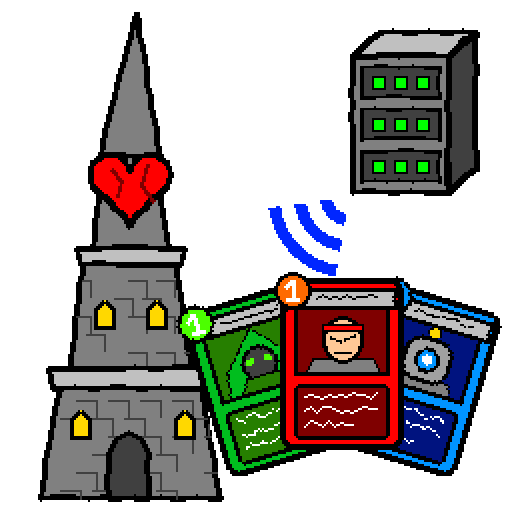

<p align="center">
  
</p>

# DeveSTSCharacterSharer

A small Blazor Server app for sharing Slay the Spire 2 character mods with friends.

- **Upload**: drag a `.zip`, `.7z` or `.rar`, or a folder, onto the page. It's uploaded right away
  (no confirm step), only the mod folder is kept, and it replaces the previous version of that
  character.
- **Download**: everyone grabs one `sts-character-sync.cmd` (or `sts-character-sync.sh` on Linux
  and macOS), drops it in their `Slay the Spire 2\mods` folder and double-clicks it. It downloads
  only the characters that changed since the last run, and puts the game's mod list in the same order
  for everyone, so you can play together.

## Running it

`docker-compose.yml`:

```yaml
services:
  sts-character-sharer:
    image: ghcr.io/devedse/devestscharactersharer:latest
    container_name: sts-character-sharer
    restart: unless-stopped
    ports:
      - "8080:8080"
    environment:
      # How your friends reach this server. It is baked into the sync script.
      - PUBLIC_URL=http://192.168.1.10:8080
      # - PUBLIC_URL=https://sts.example.com
    volumes:
      - ./data:/data
```

```sh
docker compose up -d
```

Then open `http://<host>:8080`. Images are built for amd64 and arm64 on every push: `latest` and
`1.0.<build>` from master, `beta_<branch>` and `1.0.<build>-beta` from other branches.

### Settings

| Variable        | Default | Meaning |
|-----------------|---------|---------|
| `PUBLIC_URL`    | (empty) | Address friends use to reach the server: a hostname or an IP, with or without port. Without `http://`/`https://`, IPs, `localhost` and dot-less names get `http://`, other hostnames `https://`. When empty, the address your browser used to open the page is used instead. |
| `MAX_UPLOAD_MB` | `2048`  | Largest archive accepted. |
| `MOD_LIBRARIES` | `BaseLib,STS2-RitsuLib,RitsuLib,ModConfig` | Mod ids that go at the top of everyone's mod list (comma separated). Whatever the shared mods depend on goes there too. See [The mod order](#the-mod-order). |
| `DATA_DIR`      | `/data` | Where everything is stored inside the container. |

The container runs as root, so files in `./data` are owned by root. To have them owned by your own
user, add `user: "1000:1000"` (your uid:gid) to the service and create `./data` yourself first.

### Behind a reverse proxy

Blazor Server keeps a WebSocket open to the browser, so the proxy has to pass WebSockets through
(Traefik and Caddy do this by default; nginx needs the `Upgrade`/`Connection` headers). Uploads from
the web page travel over that connection; only `curl` uploads (below) are subject to the proxy's
request body limit (nginx `client_max_body_size`).

## What gets stored from an upload

The app looks for the folder that holds a mod: `X.json` next to `X.dll` and/or `X.pck`. For the
`Yugi-0.3.0.zip` example, which contains

```
BUILD.txt  NOTES.txt  PLAY_GUIDE.md  README.txt  Yugi.source.zip  ...
Yugi/Yugi.dll  Yugi/Yugi.json  Yugi/Yugi.pck
```

only `Yugi/` is kept and everything else is thrown away. Some details:

- The character's name comes from the mod files (`Yugi.json` gives `Yugi`), so an archive with a
  versioned folder like `Yugi-0.4.0/Yugi.dll` still replaces `Yugi`. Names match case-insensitively,
  like folders on Windows.
- If the mod files sit loose at the top of the archive, only the `Yugi.*` files are kept.
- An archive containing several mods (say a character plus `BaseLib`) adds or updates each of them.
- A zip inside a zip is opened when the outer archive has no mod of its own.
- Folders can be dropped too: one character's folder, or your whole `mods` folder to add or update
  every character in it. The browser packs a dropped folder into a tar (without copying the files
  into memory) and uploads that. The sync script's hidden `.character-sync` files and
  `desktop.ini`/`Thumbs.db`/`.DS_Store` are never stored, so a folder that is already in sync counts
  as unchanged.
- Re-uploading the same build is reported as "already up to date" and doesn't make anyone download
  it again. The version is compared by a hash of the files' contents, not by file dates.
- Version, author and description shown on the page come from the mod's own json.
- The portrait on the page comes from the mod's `.pck` (a Godot resource pack). Mods made with the
  STS2 Character Creator or character kit have it at `images/packed/portraits/<id>_portrait.png`,
  mods made from the BaseLib template at `<Mod>/images/charui/character_icon.png`; when those are
  missing the HUD icon, character select or map marker image is used. Packs either contain the
  original PNG or only Godot's compiled `.ctex` texture; both work (the image inside a `.ctex` is
  a PNG or WebP). Characters without one show their initial.

Supported formats: zip, 7z, rar (v4 and v5), tar, tar.gz/bz2/xz (via
[SharpCompress](https://github.com/adamhathcock/sharpcompress)). Password protected archives are
rejected.

Uploading from a terminal works too:

```sh
curl -T Yugi-0.3.0.zip http://192.168.1.10:8080/api/upload/Yugi-0.3.0.zip
```

## The sync script

`sts-character-sync.cmd` is the same for everyone. It only contains the server address, not a list
of characters. Each run it:

1. downloads the character list with content hashes (`/api/manifest.txt`),
2. compares each hash with the one it saved in `<Character>\.character-sync` (a hidden file) last
   time,
3. downloads and unpacks only the characters that are new or changed, replacing the old folder,
4. sorts the game's mod list (see [The mod order](#the-mod-order)).

Before that it updates itself: when the server has a newer version of the script, it replaces itself
and restarts. (A running `.cmd` can't simply be overwritten, because cmd.exe keeps reading the file
from where it was; the copy and the restart run from one block cmd has already read in full.)

It uses the `curl.exe` and `tar.exe` that come with Windows 10 (1803+) and 11, so nothing needs to be
installed. Folders that aren't on the server are left alone, and so are characters that get removed
from the server. If the game is still running, the old folder is locked; the script then leaves it
untouched and reports the failure instead of leaving a half-deleted folder. Close the game and run
it again.

Options: `sts-character-sync.cmd force` re-downloads everything, `nosort` leaves the game's mod list
alone, `nopause` skips the 5 second wait at the end (useful for scheduled tasks).

### Linux and macOS

`sts-character-sync.sh` does the same with `curl` and `tar`. Put it in the game's `mods` folder
(on macOS that's inside the app: `SlayTheSpire2.app/Contents/MacOS/mods`) and run

```sh
sh sts-character-sync.sh
```

It works in the folder it's in, wherever it's started from. It downloads `.tar.gz` packages, because
GNU tar can't open zip files and `unzip` isn't always installed. To update itself it moves the new
version over the old file; the running shell keeps reading the old one, then starts the new one.
Options: `force` and `nosort`.

### The mod order

The game loads mods in the order of `mod_settings.mod_list` in its `settings.save`, and adds mods it
hasn't seen before at the end. Co-op only works when everyone loads the same mods in the same order,
so friends who got the characters at different times can't join each other. After syncing, the
script sends `settings.save` to the server (`POST /api/sort-mods`), which sends it back with the mod
list sorted the same way for everyone:

1. libraries: the `MOD_LIBRARIES` and whatever a shared mod depends on,
2. all other mods that aren't characters: Workshop mods, mods only you have, and shared mods
   without character art,
3. the characters shared on the server.

Each group is A-Z by mod id, ignoring case, and a mod's known dependencies come before it. A mod
counts as a character when its `.pck` has character art (what the page shows as its portrait). Mods
only some players have just slot in, they don't change the order of the others. Characters that
were just downloaded are added to the list right away (copying how the other shared characters are
listed), so the first launch already has the right order. Nothing is switched on or off.

Only the mod list changes; the rest of the file stays byte for byte the same, and the server doesn't
keep it. When the order changes, the previous file is kept as `settings.save.bak`. The script skips
sorting while the game is running (the game writes `settings.save` when it exits) and when a
character could not be updated. It looks for `settings.save` in:

| OS      | Folder |
|---------|--------|
| Windows | `%APPDATA%\SlayTheSpire2\steam\<Steam id>\` |
| Linux   | `~/.local/share/SlayTheSpire2/steam/<Steam id>/`, or inside Proton's `compatdata/2868840` when the game runs through Proton |
| macOS   | `~/Library/Application Support/SlayTheSpire2/steam/<Steam id>/` |

Players who arrange the order themselves (Better Mod Menu, LoadOrderManager) can use `nosort`.

## Data folder

```
data/
  characters/<Name>/         the mod folder exactly as players get it
  packages/<Name>.zip        prebuilt download
  packages/<Name>.tar.gz     the same for the Linux/macOS script
  packages/<Name>.info.json  upload time and original archive name
  packages/<Name>.portrait.* portrait taken from the mod's .pck
  keys/                      ASP.NET data protection keys
  work/                      temporary upload space, cleaned on start
```

You can also copy a mod folder into `data/characters/` by hand and restart the container; it's
picked up and packaged on start.

## Security

There is no login. Anyone who can open the page can upload or remove characters, and a character
contains a `.dll` that runs inside your friends' game. Only expose it to people you trust, or put
authentication in front of the web page in your reverse proxy. Keep `/api/manifest.txt`,
`/api/package/*`, `/api/sort-mods`, `/sts-character-sync.cmd` and `/sts-character-sync.sh` reachable
without it, because the scripts can't log in.

## Development

```sh
dotnet run --project src/DeveSTSCharacterSharer   # stores data in src/DeveSTSCharacterSharer/data
dotnet test
docker build -t devestscharactersharer .
```
